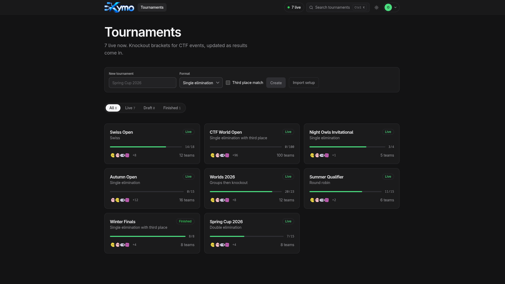
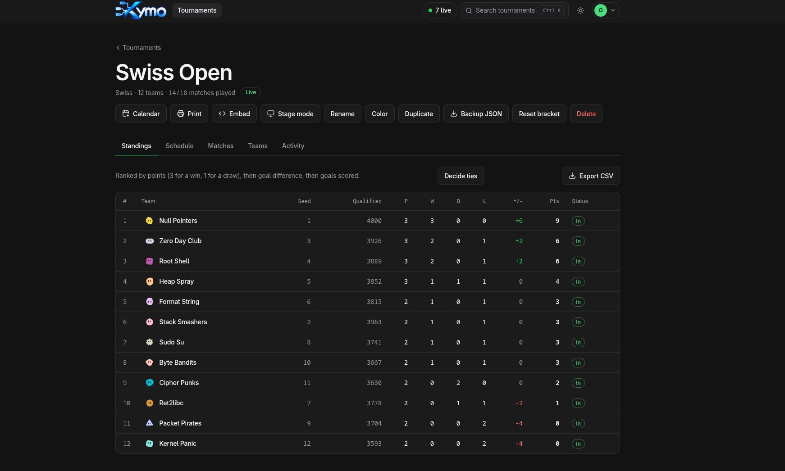
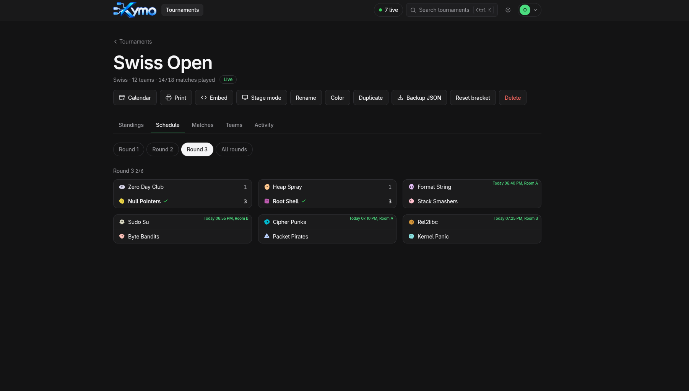
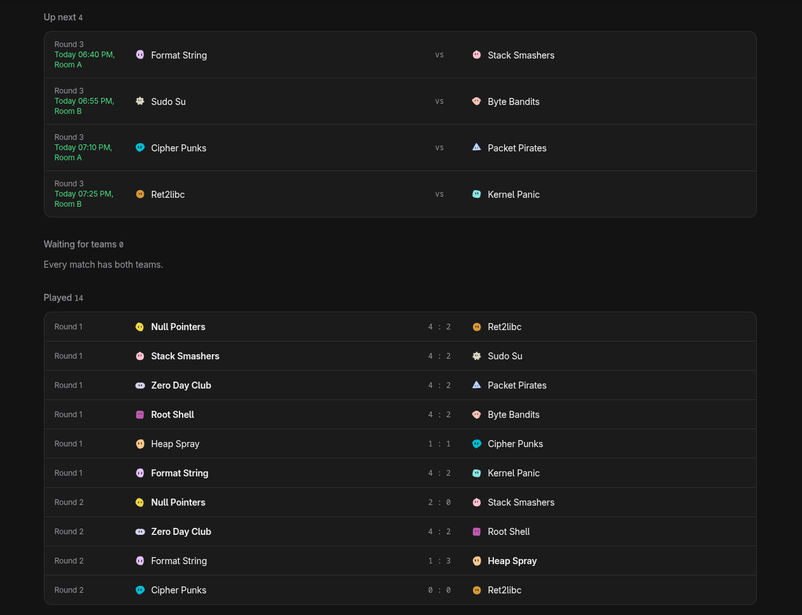
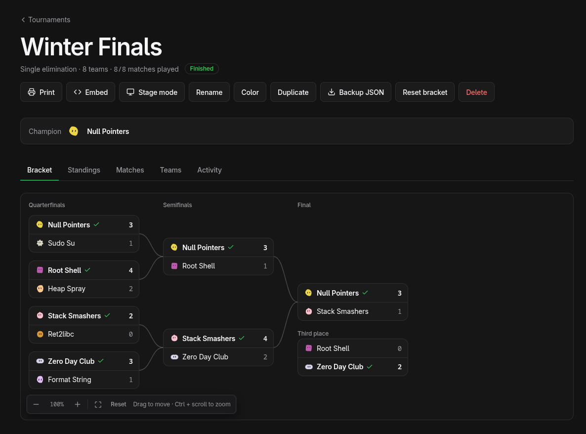
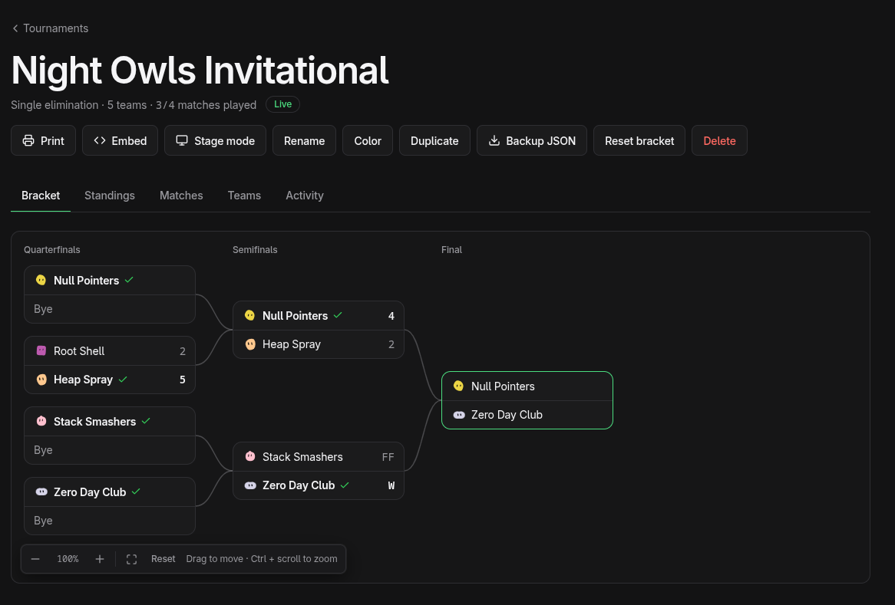
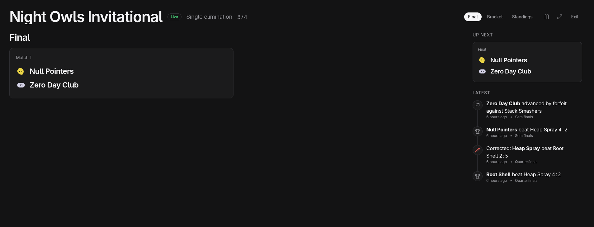
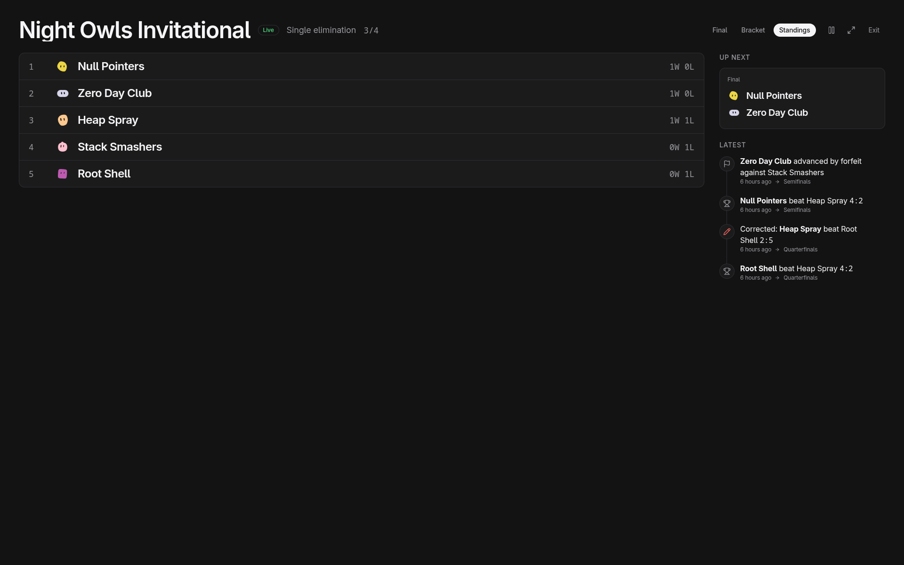
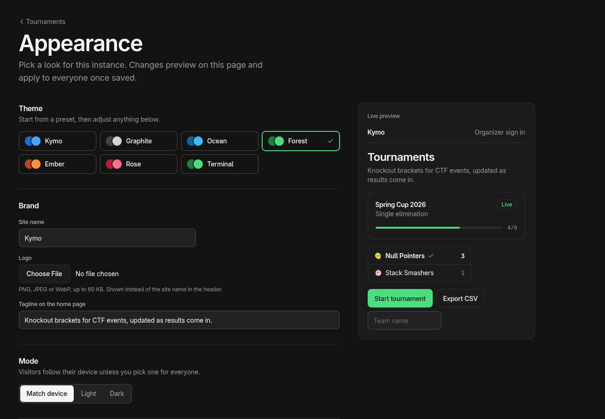

# Kymo

[](https://github.com/Okymi-X/kymo/actions/workflows/ci.yml)
[](https://github.com/Okymi-X/kymo/releases)
[](LICENSE)

Open source tournament manager for CTF events. Run a knockout, double elimination, round robin, groups then knockout or Swiss tournament, show it live on a projector, and embed it on any site. A Rust API with a React interface and SQLite storage, in one small binary.



## Contents

- [Why Kymo](#why-kymo)
- [Features](#features)
- [Screenshots](#screenshots)
- [Quickstart](#quickstart)
- [Configuration](#configuration)
- [Running an event](#running-an-event)
- [Use the API from a script](#use-the-api-from-a-script)
- [Formats](#formats)
- [Challenge instances with Docker or Podman](#challenge-instances-with-docker-or-podman)
- [Separate lab host](#separate-lab-host)
- [Backup and restore](#backup-and-restore)
- [Private VPN for every player](#private-vpn-for-every-player)
- [Deploying on your own server](#deploying-on-your-own-server)
- [Run with Docker](#run-with-docker)
- [Development](#development)
- [Project layout](#project-layout)
- [Credits and license](#credits-and-license)

## Why Kymo

CTF events have a few recurring problems: a score that is disputed, players asking where they play next, and an organizer page that gets shared on screen by mistake. Kymo is built around those.

- Every result, correction and forfeit goes into a public activity log with its time.
- Players can follow their team and see their next match, time and room.
- The projector view is a separate page with no controls, so nothing private is ever on screen.

## Features

- **Jeopardy CTFs, solo or in teams:** categories, static or dynamic points, hints with a point cost, attachments, flag formats and regex flags, attempt limits, a scoreboard that stays hidden until you publish it, and per teammate progress. Players sign up, form teams with invite codes, register for an event and play in the browser.
- **Challenge instances:** a challenge can start a private Docker container per player or team, with CPU, memory, process and lifetime limits, an expiry reaper and cleanup of orphaned containers.
- **Roles and safety:** visitors, players, referees, monitors and admins; per endpoint rate limits with automatic and manual bans, a request log, a moderation audit trail, health and backup tools, and event bundles you can export and import.
- **Five formats:** single elimination (optional third place match), double elimination, round robin, groups then knockout, and Swiss. Any of them can be best of 1, 3, 5 or 7, entered game by game.
- **Organizer tools:** enter and correct scores, forfeits, undo the newest result, schedule matches with a place, drag teams into seeding order, seed by qualifier score or at random, decide ties by hand, rename, duplicate, back up as JSON, import a setup file.
- **A live map of the bracket:** drag it, zoom at the cursor, jump with the minimap. Every format has a Bracket tab.
- **Standings, schedule, matches, teams, activity:** all paginated with search, so a 100 team event stays readable.
- **Stage mode** at `/t/{slug}/stage`: a rotating projector view with the current round, standings and the latest results. It fits one screen with no scrolling.
- **Embeds** at `/embed/{slug}`: copy an iframe snippet from the Embed button. Only these pages may be framed.
- **Calendar feed** at `/api/v1/tournaments/{slug}/calendar.ics` for scheduled matches.
- **Appearance in the database:** site name, logo, colors for light and dark, type, corner radius, density, page tint, bracket line style and team avatars. A tournament can also carry its own accent color.
- **Live updates** over server sent events, with no page refresh.
- **Webhooks** that post results, corrections, forfeits and schedules to Discord, Slack or any URL that accepts JSON.
- **Referee tokens**: a token that can only record results and schedules for the tournaments you choose, with its own sign in.
- **Captain reporting**: each team can get a private link to submit its score, which waits for your approval.
- **Playing now**: mark a match as started, and spectators see a LIVE badge while chat gets a message.
- **Bracket image**: save the whole bracket as a PNG or SVG to post or print.
- **Late match panel**: planned matches that should have started, with one click forfeits.
- **Ladder** at `/ladder`: points across every tournament on the site.
- **Link previews** when a tournament link is pasted in chat, and an installable app on phones.
- **API tokens** with an expiry for scripts and score importers.
- **Accessible by default:** keyboard operation, visible focus, a skip link, screen reader announcements while reordering teams, and light and dark themes that follow the device.

## Screenshots

### Standings, schedule and matches

A Swiss tournament in progress. Standings rank by points, goal difference and goals scored. The organizer can decide ties by hand, and the schedule shows one round at a time.







### Brackets

Brackets are a map you can move around. A finished tournament shows its champion, and a live one highlights the match to play next.





### Stage mode

A full screen view for a projector. It rotates between the current round, the bracket and the standings, and keeps what is next and the latest results beside it.





### Appearance

Pick a preset or set your own colors, type, radius, logo, tint and bracket lines. Changes preview live and apply to everyone once saved.



## Quickstart

You need Rust (stable) and Node with pnpm.

```sh
git clone https://github.com/Okymi-X/kymo.git
cd kymo
(cd web && pnpm install && pnpm build)

export KYMO_ADMIN_PASSWORD='at least 12 characters'
cargo run -p kymo-server seed-demo   # optional: eight sample tournaments
KYMO_ADDR=127.0.0.1:8787 cargo run -p kymo-server
```

Open http://127.0.0.1:8787 and sign in as organizer with that password.

## Configuration

| Variable | Default | Purpose |
| --- | --- | --- |
| `KYMO_ADMIN_PASSWORD` | required | Organizer password, at least 12 characters |
| `KYMO_ADDR` | `127.0.0.1:8080` | Address to listen on |
| `KYMO_DATABASE_URL` | `sqlite://kymo.db` | SQLite database file, created on first run |
| `KYMO_TRUST_PROXY` | off | Set to `1` behind a reverse proxy so the last `X-Forwarded-For` entry is the client address (needed for correct rate limits and bans) |
| `KYMO_BACKUP_DIR` | off | Directory for scheduled database backups (created private) |
| `KYMO_BACKUP_EVERY_HOURS` | `24` | Hours between scheduled backups |
| `KYMO_BACKUP_KEEP` | `7` | Backups to keep |
| `KYMO_INSTANCES` | off | `docker` runs challenge containers on this machine (events can still use lab hosts); `labs` runs none here and leaves everything to [lab hosts](#separate-lab-host) |
| `KYMO_INSTANCE_HOST` | `127.0.0.1` | Host name players are told to connect to |
| `KYMO_INSTANCE_BIND` | `0.0.0.0` | Address container ports are published on |
| `KYMO_VPN` | off | Set to `1` for a private VPN network per player (needs `KYMO_INSTANCES=docker`) |
| `KYMO_VPN_HOST` | required with the VPN | Name or address players connect to, written into their profiles |
| `KYMO_VPN_PORT` | `1194` | UDP port on the server for the VPN |
| `KYMO_VPN_BIND` | `0.0.0.0` | Address the VPN port is published on |
| `KYMO_VPN_DIR` | `kymo-vpn` | Directory shared with the gateway container (must be a path the container platform can mount) |
| `KYMO_VPN_IMAGE` | `localhost/kymo/vpn-gateway:1` | Gateway image, built from `deploy/vpn-gateway` |
| `KYMO_VPN_TUNNEL` | `10.8.0.0/16` | Address range handed to players' VPN tunnels |
| `KYMO_VPN_LABS` | `10.77.0.0/16` | Range split into one private /27 network per player or team (2048 by default) |
| `KYMO_VPN_CERT_DAYS` | `60` | How long a player's VPN certificate is valid |
| `KYMO_VPN_BIND_OPTIONS` | empty | Extra bind mount options, for example `z` on SELinux hosts |

Everything else, including the look of the site, is stored in the database and changed from the interface.

## Running an event

1. **Create** a tournament from the home page: pick a format and a name.
2. **Add teams**, one per line. Add a qualifier score after a comma to seed by score (`Alpha, 900`).
3. **Seed** by dragging, or choose manual, random or score seeding when you start.
4. **Start**, then enter results from the bracket, the schedule or the matches list. Click a match to enter a score, record a forfeit, or plan a time and place.
5. **Show it**: open Stage mode on the projector, share the tournament link with players, or embed it on your site.

If a result was wrong, correct it from the same dialog. A correction is refused when a later match already depends on it, so the bracket never ends up inconsistent. The newest result can also be undone from the Activity tab.

## Use the API from a script

Create a token on the API tokens page (choose an expiry), then:

```sh
curl -H "Authorization: Bearer $TOKEN" -H 'Content-Type: application/json' \
  -X PUT http://127.0.0.1:8787/api/v1/admin/tournaments/1/matches/0/result \
  -d '{"score_a": 3, "score_b": 1}'
```

Create a whole tournament from a file. The schema is `docs/schema/tournament-import.schema.json` and an example is `docs/examples/spring-cup.json`:

```sh
curl -H "Authorization: Bearer $TOKEN" -H 'Content-Type: application/json' \
  -X POST http://127.0.0.1:8787/api/v1/admin/import --data @docs/examples/spring-cup.json
```

Reads are public: `GET /api/v1/tournaments` and `GET /api/v1/tournaments/{slug}`. An API token cannot create other tokens.

## Formats

| Format | Teams | Notes |
| --- | --- | --- |
| Single elimination | 2 to 256 | Byes fill the first round. Optional third place match. |
| Double elimination | 3 to 256 | Winners and losers brackets, grand final and a reset match if the losers side wins. |
| Round robin | 3 to 32 | Everyone plays everyone. 3 points for a win, 1 for a draw. |
| Groups then knockout | 3 to 32 | 2 to 8 groups, 1 to 4 teams per group advance. Same group teams are kept apart in the first knockout round. |
| Swiss | 4 to 256 | 1 to 12 rounds, or log2 of the team count. Each round is paired once the last one is played, with no rematches and one bye at most per team. |

Teams level on points, difference and goals are ordered by the organizer's tiebreak list, then by seed. In a groups tournament that order also decides who qualifies.

## Challenge instances with Docker or Podman

Set `KYMO_INSTANCES=docker`, `KYMO_INSTANCE_HOST` (what players connect to) and `KYMO_INSTANCE_BIND` (where container ports are published; `127.0.0.1` for a local test). The server talks to the Docker API. With Docker, your user needs access to its socket (the `docker` group). With rootless Podman, run `systemctl --user enable --now podman.socket` and set `DOCKER_HOST=unix:///run/user/$UID/podman/podman.sock`.

An instance is shown to the player as *starting* until its port really accepts connections (checked through the gateway for a private lab); if it never does, or the container later exits, it is stopped, marked failed with a reason and does not use the player's start budget. `lab/` holds three tiny example challenge images (busybox web servers and a raw TCP service). Build them with `podman build -t localhost/kymo-lab/flag-server:1 lab/flag-server` (or `docker build`), and likewise `page-source`, then point a challenge's instance image at them. To check the runtime against a real daemon: `KYMO_TEST_IMAGE=localhost/kymo-lab/flag-server:1 cargo test -p kymo-instances --features docker --test docker`.

## Separate lab host

By default the machine that runs Kymo also runs the challenge containers. A challenge is software that players attack, so if one is broken into, the attacker is on the machine that holds your accounts, flags and database. A **lab host** moves the containers to another machine. The platform asks it, over an authenticated and encrypted API, to start and stop them, and an event chooses where its instances run.

```
players ──► platform (web, accounts, scores)  ──── HTTPS + token ────►  lab host (Docker, challenge images)
   └──────────────────── connect to the instance on the lab host's public address ───────────────────►
```

- **Same host** (the default): the event uses this machine's own runtime and address.
- **Separate host**: add the lab host in the admin pages (Lab hosts) and pick it in the event's *Where instances run*. Players are told the lab host's address.
- **Both**: any number of lab hosts, and each event picks one. An event on a lab host can be moved only while none of its instances run.
- **Solo and team events** behave the same; only the owner of an instance changes.
- **Private VPN on a lab host**: see [Players reach a lab host through its VPN](#players-reach-a-lab-host-through-its-vpn). With it nothing vulnerable is published on the internet.

### Players reach a lab host through its VPN

Published ports are the weak point of a CTF server: every instance is a vulnerable machine on an open port, reachable by anyone on the internet who finds it. A lab host avoids that with a **gateway of its own**. It is on by default in the installer (`--no-vpn` turns it off).

```
player ── OpenVPN (UDP 1194) ──► lab host gateway ──► the player's private lab network ──► their instances
                                      (nothing else is open; no instance has a public port)
```

- **One port faces players**: the gateway's UDP port. The platform's API port is for the platform only. Instances, containers and virtual machines alike, sit on a private network per player or team that no one else can reach, and are not published on any port.
- **The platform keeps the authority**: it issues each player's certificate, decides who may reach which lab, and pushes the result to the lab host (`PUT /v1/vpn/files`, attach, firewall rules, kick). The lab host only runs the gateway container and checks every value it is given (paths, network names, address range).
- **One authority per lab host.** A certificate for one lab host opens nothing on another, and a new profile for one host does not revoke your profile for another.
- **Machines are machines.** On a lab network a virtual machine is a tap device on the network's bridge with the address the platform reserved for it (a small built-in DHCP server hands the guest that address). Every port, TCP and UDP, and ping, is open on that one address, so players scan it with `nmap` like a HackTheBox machine; nothing is mapped or listed. A manifest chooses how it is shown with `"display"`: `machine` (just the address, the default for a virtual machine) or `service` (address and port, the default for a container, like a HackTheBox challenge). A container always has its own address on the network and every port it listens on is reachable.
- **Audit**: every instance start, restart and stop (and every failure), and every VPN profile download, is recorded with the player, the address it came from, the challenge, the lab host and the private address given. Monitor, Audit has search (address, player, challenge), a filter fed by what was recorded, and paging.
- **Virtual machines need a rootful Docker** on the lab host and the right to make a network device: the installer's service unit grants exactly `CAP_NET_ADMIN` and `CAP_NET_RAW`. With rootless Podman the lab network's bridge lives inside the user's network namespace, out of reach. Containers work with either. The DHCP exchange is read from a packet socket, so no host firewall rule is needed.
- **Players** open the event, download the profile for it (`POST /vpn/profile?lab_host=ID`, shown on the event page), connect, and start an instance; its private address appears when it answers.
- **VPN only**: a lab host with a gateway refuses to publish a port at all (`KYMO_LAB_VPN_ONLY`, default on), so a mistake in an event's settings cannot expose a machine. The Lab hosts page shows each host's gateway, and the event settings choose the host and the network mode together.
- **Firewall**: open UDP 1194 to players and TCP 7400 to the platform. Nothing else needs opening.
- **Platform setup**: `KYMO_VPN=1` works with `KYMO_INSTANCES=labs` (no gateway on the platform itself, so no `KYMO_VPN_HOST` needed). The platform's `KYMO_VPN_LABS` must lie inside the lab host's `KYMO_LAB_VPN_POOL`; the platform says so if it does not.

### Install a lab host

On the new machine (Linux with Docker and systemd) download `kymo-lab-vX.Y.Z-linux-x86_64.tar.gz` from the releases page, unpack it and run the installer:

```sh
sudo ./install-lab.sh --public-host 203.0.113.7 --allow-from 198.51.100.10
```

`--public-host` is the lab host's address as players reach it, `--allow-from` is the platform's address (the API then answers only that address; omit it to allow any address that has the token). The installer creates a service user, a self-signed certificate and a token, installs and starts the `kymo-lab` service, and prints what to enter in the platform:

```
API address:             https://203.0.113.7:7400
Token:                   ...
Certificate fingerprint: A4:7C:...
Public address:          203.0.113.7
```

In the platform open **Lab hosts**, **Add a lab host** and paste those four values. It is saved and tested at once, and the answer says plainly what is wrong if the lab host cannot be reached. Running the installer again upgrades the program and keeps the token, certificate and manifests. `sudo ./install-lab.sh --uninstall [--purge]` removes it.

Then, on the lab host:

1. **Open the ports.** TCP 7400 (the API) to the platform only, and the instance ports to players: Docker publishes each instance on a high port, by default 32768 to 60999 (`cat /proc/sys/net/ipv4/ip_local_port_range`).
2. **Put the challenge images there** (`docker pull`, or `docker build -t localhost/kymo-lab/flag-server:1 lab/flag-server`) and describe each in a **manifest**, then restart the service. `kymo-lab check` verifies the settings, Docker access and manifests.

### Manifests

A manifest is a JSON file in `/etc/kymo-lab/manifests/` that describes one image. In the default `manifest` mode the lab host runs **only** images it has a manifest for, so even a stolen platform token cannot make it run something else:

```json
{
  "artifact": "localhost/kymo-lab/flag-server:1",
  "runtime": "docker",
  "port": 8000,
  "env": { "MODE": "ctf" },
  "env_allow": ["FLAG"],
  "cpu_millis": 500, "memory_mb": 128, "pids": 64, "max_ttl_secs": 3600
}
```

`artifact` is the image reference the challenge uses. The manifest decides the port and limits; the platform can only ask for less. It can set only the environment variables named in `env_allow`. `deploy/lab/manifests/` has examples for the demo images. `KYMO_LAB_MODE=open` accepts any valid image within the caps instead, which is convenient on a private network and weaker.

### Configuration of the lab host

The installer writes `/etc/kymo-lab/lab.env`; `deploy/lab/lab.env.example` documents every variable.

| Variable | Default | Purpose |
| --- | --- | --- |
| `KYMO_LAB_TOKEN` | required | At least 24 characters; the platform authenticates with it (`KYMO_LAB_TOKEN_FILE` reads it from a file) |
| `KYMO_LAB_ADDR` | `0.0.0.0:7400` | Where the API listens |
| `KYMO_LAB_NAME` | hostname | Name shown in the platform |
| `KYMO_LAB_MODE` | `manifest` | `manifest` or `open` |
| `KYMO_LAB_RUNTIMES` | what is installed | `docker`, `vm` or both |
| `KYMO_LAB_MAX_INSTANCES` | `100` | Most instances at once; further starts get "the lab host is full" |
| `KYMO_LAB_ALLOW_FROM` | any | Comma separated addresses or CIDR ranges allowed to call the API |
| `KYMO_LAB_TLS` | `on` | `off` serves plain http, only behind a proxy or on a private network |
| `KYMO_LAB_TLS_NAMES` | hostname | Extra names and addresses for the generated certificate |
| `KYMO_LAB_TLS_CERT`, `KYMO_LAB_TLS_KEY` | generated | Use your own certificate and key |
| `KYMO_LAB_BIND` | `0.0.0.0` | Address instance ports are published on (without the VPN) |
| `KYMO_LAB_VPN_HOST` | off | Set it to run the lab host's own VPN gateway: the name or address players connect to |
| `KYMO_LAB_VPN_PORT` | `1194` | The gateway's UDP port |
| `KYMO_LAB_VPN_POOL` | `10.77.0.0/16` | The range lab networks are made from |
| `KYMO_LAB_VPN_ONLY` | `1` | Refuse every instance that is not on a lab network |
| `KYMO_LAB_VPN_IMAGE` | `localhost/kymo/vpn-gateway:1` | The gateway image (the installer builds it from `deploy/vpn-gateway`) |
| `KYMO_LAB_DATA` | `/var/lib/kymo-lab` | State file and certificate |
| `KYMO_LAB_MANIFESTS` | `/etc/kymo-lab/manifests` | Manifest directory |

Commands: `kymo-lab` runs it, `kymo-lab check` verifies the setup, `kymo-lab prepare` unpacks virtual machine images now, `kymo-lab fingerprint` prints the certificate fingerprint, `kymo-lab version`.

### Virtual machines

A lab host can also run whole machines, such as the OVA exports of VulnHub boxes, with QEMU (KVM-accelerated when the host has it). A challenge's instance then gives each player or team a private, pristine copy of the machine, and players connect to its services (a web server and SSH, say) on the lab host's address.

Set it up on the lab host:

1. Install QEMU: `sudo ./install-lab.sh --with-vm` does it on Debian, Ubuntu, Fedora and Arch (it also adds the service user to the `kvm` group). On a cloud server KVM needs nested virtualization; without `/dev/kvm` machines still run, in plain emulation that is many times slower, and the Lab hosts page says so.
2. Copy the image (`.ova`, `.vmdk`, `.vdi`, `.qcow2`, `.img` or `.raw`) to `/var/lib/kymo-lab/images/`.
3. Describe it in a manifest, `runtime` `vm`:

```json
{
  "artifact": "gaara",
  "runtime": "vm",
  "file": "Gaara.ova",
  "ports": [ { "name": "web", "port": 80 }, { "name": "ssh", "port": 22 } ],
  "memory_mb": 1024,
  "cpu_millis": 2000,
  "boot_timeout_secs": 240,
  "max_ttl_secs": 3600
}
```

4. Restart the service. The image is unpacked once, in the background (`kymo-lab prepare` does it on the spot; about ten seconds for a 1 GB OVA); until then a start is "try again shortly" and costs the player nothing. `kymo-lab check` shows what is ready.
5. In the challenge, set the instance image to the **artifact name** (`gaara`). The manifest decides the rest. Open the machine port range (`KYMO_LAB_VM_PORTS`, default 40000 to 40999) to players.

| Manifest field | Meaning |
| --- | --- |
| `file` | The image, a plain file name in the images directory |
| `ports` | Up to 8 services, primary first. The first is the instance's address, the others are shown by name |
| `memory_mb`, `cpu_millis` | Memory and CPU cores (1000 per core), clamped to the lab host's caps (`KYMO_LAB_MAX_MEMORY_MB`, `KYMO_LAB_MAX_CPUS`) |
| `boot_timeout_secs` | How long the platform waits for the machine to answer (10 to 1800, default 180) |
| `disk` | `sata` (default, works with nearly everything), `ide` or `virtio` (fastest, needs guest drivers) |
| `nic` | `e1000` (default), `virtio` or `rtl8139` |
| `firmware` | `bios` (default, what VirtualBox exports use) or `uefi` |
| `display` | `machine` (players get just the address, every port open on it: the default for a virtual machine) or `service` (address and port: the default for a container). On a lab network `ports` only names what to wait for before the machine counts as ready (the first port) |

How it behaves:

- **Every instance is disposable.** The image is converted once into a base that is never written to, and each instance runs from its own copy-on-write overlay that is deleted when it ends. A player can wreck the machine; the next start is pristine, and starting costs almost nothing.
- **A machine is shown as ready only when its guest accepts connections.** QEMU accepts the host side of a forwarded port while the guest is still booting, so the lab host asks QEMU itself whether the guest took a connection, and the platform waits for that (up to `boot_timeout_secs`). Players see "starting" until then.
- **Isolation.** Networking is QEMU's user mode with `restrict=on`: the guest cannot reach the lab host, its network or the internet, and only the listed ports lead in. Machines run as the unprivileged service user.
- **VirtualBox exports just work.** The network card is placed where VirtualBox puts it, so a guest that configures `enp0s3` (the usual VulnHub case) finds it and gets its address.
- **See what the guest is doing.** In the Lab hosts page, *What is running*, a machine has a **Console** button with a screenshot of its screen. A login prompt means it booted; anything else tells you where it is stuck.
- **Time limits and restarts.** The lab host enforces the machine's time limit itself. Machines survive a restart of the `kymo-lab` service and are found again.
- **Limits today.** The first disk of an image is used; one machine is one instance (no private network between several); CPU is the number of cores given to the guest, not a hard share of the host.

### How the platform and the lab host cooperate

- **The platform builds the name** of every instance (`kymo-c<challenge>-<u|t><owner>-<random>`) and records the run in its database *before* asking the lab host to start it. The lab host validates the name (characters, prefix, not in use) and the request, and refuses anything else.
- **Nothing is shown to a player until the service answers.** The platform connects to the lab host's public address and port, the way a player will, so a firewall in the way is caught too. If it never answers, the run fails with a reason and does not use the player's start budget.
- **Reconciliation.** The platform decides what should run; the lab host knows what does run. Every 30 seconds the platform's reaper removes lab host containers it has no run for (listing first and reading its runs second, so a start under way is never taken for an orphan), and **Clean up** on a lab host card does it on demand. The lab host also enforces expiry on its own clock, so a platform that is down cannot leave containers running, and it remembers its instances across restarts.
- **Isolation on the lab host.** Each instance has its own network and runs with no capabilities, no privilege escalation, a read-only root and CPU, memory and process limits. The lab host labels its containers in its own namespace (`kymo.managed=lab`), so it can share a Docker daemon with a platform without either touching the other's containers.
- **Health.** The platform checks every lab host every 30 seconds. Operations lists them and counts an unreachable one as *degraded*.

### Security

- The API needs the bearer token (compared in constant time); ten wrong tokens from an address lock it out for a minute; `KYMO_LAB_ALLOW_FROM` restricts the source addresses.
- The connection is HTTPS. The installer's certificate is self-signed, so the platform **pins its fingerprint** instead of trusting a certificate authority: nobody can stand in for the lab host, and no domain name is needed. A lab host behind a proxy with an ordinary certificate needs no fingerprint. The platform warns on any unencrypted connection.
- The token is stored in the platform's database (back-ups include it, treat them as secrets) and is never shown again once saved.
- The service user belongs to the `docker` group, which is equivalent to root on that machine. That is why a lab host should be a machine of its own that holds nothing but challenges.

### The lab API

Everything the platform does is available to scripts. JSON over HTTPS, `Authorization: Bearer <token>`, `-k` or `--pinnedpubkey` for the self-signed certificate:

| Request | Does |
| --- | --- |
| `GET /healthz` | Liveness, no token |
| `GET /v1/health` | Version, runtime, mode, load, uptime |
| `GET /v1/artifacts` | The images this lab host will run, with their ports and (for machines) whether the image is ready |
| `POST /v1/instances` | Create and start `{name, instance_id, spec, meta}`; `201` with the instance, `409` for a used name, `400` for a refused request, `503` when full |
| `GET /v1/instances` | Every instance with its state, port, owner metadata and expiry |
| `GET /v1/instances/{id}` | One instance, by name, container id or platform instance id |
| `POST /v1/instances/{id}/restart` | Remove it and start it again under the same name |
| `GET /v1/instances/{id}/screen` | A virtual machine's screen as a PNG |
| `GET /v1/ready?port=N` | Whether the service behind a published port answers (for a machine, whether the guest took a connection) |
| `POST /v1/instances/{id}/stop`, `DELETE /v1/instances/{id}` | Remove it; removing a missing instance succeeds |
| `POST /v1/reconcile` | `{keep: [instance ids], grace_secs}`: remove everything not listed |
| `POST /v1/cleanup` | Remove expired instances now |
| `GET /v1/log` | The lab host's recent actions |

```sh
curl -sk -H "Authorization: Bearer $TOKEN" https://203.0.113.7:7400/v1/instances
```

The platform side is the admin API (`/api/v1/admin/labs`: list, add, update, delete, test, list instances, reconcile, and `PUT /admin/events/{id}/lab` to choose a lab host for an event), and the same operations are in the **Lab hosts** page.

## Backup and restore

`GET /api/v1/admin/ops/backup/download` (organizer) returns a consistent snapshot of the whole database. To restore, stop the server and run `kymo-server restore backup.db`; the current database is kept as `<name>.pre-restore-<time>`. A single Jeopardy event can be exported and imported as a bundle with `GET /api/v1/admin/events/{id}/export` and `POST /api/v1/admin/events/import`.

## Private VPN for every player

By default an instance gets a port on the server, and anyone who can reach the server can reach it. In **VPN mode** an event's instances live on private networks instead:

```
 player's laptop                         your server
 +--------------+    UDP 1194     +---------------------------+
 | OpenVPN      |  ============>  | gateway container         |
 | (own profile)|                 |  one tunnel address each  |
 +--------------+                 |  firewall: default deny   |
                                  +--+-----------+-----------+
                                     | allowed   | not allowed
                              +------v----+  +---v-------+
                              | lab of    |  | lab of    |
                              | player A  |  | player B  |   no route out,
                              | (private) |  | (private) |   no route between labs
                              +-----------+  +-----------+
```

- Every player (or team, in team events) gets an **isolated lab network** with no route to the internet and no route to other labs. Their instances start inside it at a private address, with nothing published on the host.
- Every account gets its **own OpenVPN profile** (one file, certificate and key inside). The gateway gives each profile a fixed tunnel address and a firewall that allows that address to reach **only its own lab**. Players cannot reach each other's tunnels or labs.
- Teammates share the team's lab, each with their own profile. Leaving or being removed from a team closes the lab to that player immediately.
- Downloading a new profile revokes the old one. A ban or the admin's *Revoke* removes the player's access and drops their session. Certificates are also on a revocation list.

### Setting it up

You need a Linux host, a container platform the Kymo server can talk to (rootful Docker, or Podman through its Docker compatible socket), the `/dev/net/tun` device, and one UDP port reachable from your players (default 1194).

1. **Build the gateway image** (a small Alpine image with OpenVPN and iptables; it holds no secrets):

   ```sh
   docker build -t localhost/kymo/vpn-gateway:1 deploy/vpn-gateway     # or: podman build ...
   ```

2. **Turn it on** in the server environment, next to the instance settings:

   ```sh
   KYMO_INSTANCES=docker
   KYMO_VPN=1
   KYMO_VPN_HOST=vpn.example.org      # what players connect to; a DNS name or an IPv4 address
   KYMO_VPN_DIR=/var/lib/kymo/vpn     # an absolute path on the host
   ```

   On first start Kymo creates its own certificate authority, writes the gateway's config and certificates into `KYMO_VPN_DIR`, starts the container `kymo-vpn-gateway`, and logs `vpn ready`. If the gateway cannot start (image missing, platform down) the server still starts, the *Operations* page shows what is wrong, and the maintenance task retries every 10 minutes.

3. **Open the UDP port** in your firewall (`ufw allow 1194/udp`). Only this port needs to be reachable.

4. **Switch an event to VPN mode:** *Manage events*, open the event, **Overview**, **Instance network**, choose *Private VPN*. Do this while no instance is running.

5. **Players** open the event page, follow *Your private network* (install OpenVPN 2.5 or newer, download the profile, connect), then start their instances. The challenge shows the private address, for example `10.77.0.10:8000`.

6. **Check it** on *Operations*: the gateway should say *Running*, with the private networks and players it knows. *Sync the gateway now* repairs any drift. The same page can revoke a player's VPN by user id.

### Things to know

- **Run Kymo on the host** (the systemd unit in `deploy/`), not inside a container, when you use the VPN. The gateway's directory is mounted by the container platform, which resolves the path on the host.
- **Do not run other containers on the networks Kymo creates**, and keep untrusted containers off the host's default network. Isolation between labs relies on them being separate networks; Kymo attaches only the gateway to them. Challenge containers run with no capabilities, no new privileges and CPU, memory and process limits.
- **The certificate authority's private key is stored in the database** (setting `vpn_ca`), so a database backup restores every issued profile. Treat backups as secrets. Losing the database means players download new profiles.
- **Unused labs are removed** 10 minutes after their last instance stops, and as soon as the event ends. They are created again on demand.
- **Limits:** by default 2048 private networks (one /27 each, 21 instances per network) and about 65,000 players. Change the ranges with `KYMO_VPN_TUNNEL` and `KYMO_VPN_LABS` before the first start. How many labs a single gateway handles comfortably has not been measured here; each lab adds one network interface to the gateway, so very large events may want several servers.
- **Rootless Podman** is fine for trying it out. The gateway disables OpenVPN's kernel fast path (DCO), which rootless containers cannot use; player profiles do not need to, because players run OpenVPN on their own machines. On rootless Podman, containers on the host's default network can still route to lab addresses, so use rootful Docker or a dedicated host for real events.
- **Verify a setup yourself** with the integration test, which starts a gateway, two labs and two VPN clients and checks reach, isolation and revocation:

  ```sh
  KYMO_TEST_CLI=docker \
  KYMO_TEST_GATEWAY_IMAGE=localhost/kymo/vpn-gateway:1 \
  KYMO_TEST_IMAGE=localhost/kymo-lab/flag-server:1 \
  cargo test -p kymo-vpn --features docker --test gateway -- --nocapture
  ```

## Deploying on your own server

A complete setup is one binary, one SQLite file and, optionally, a container platform for instances. The files in `deploy/` are starting points.

1. **Build.** You need Rust (stable), Node 22 and pnpm. The web interface is embedded in the binary, so build it first:

   ```sh
   cd web && pnpm install --frozen-lockfile && pnpm build && cd ..
   cargo build --release -p kymo-server        # target/release/kymo-server
   ```

   Or build the container image with `docker build -t kymo .` (it does both steps).

2. **Configure.** Copy `deploy/kymo.env.example` to `/etc/kymo/kymo.env` and edit it. At least set `KYMO_ADMIN_PASSWORD`. Keep the file readable only by root and the service user.

3. **Run as a service.** `deploy/kymo.service` is a hardened systemd unit (dedicated user, read-only system, writable state directory only). The install commands are in its header.

4. **Put HTTPS in front.** Run Kymo on `127.0.0.1:8080` and use a reverse proxy: `deploy/Caddyfile.example` (automatic certificates) or `deploy/nginx.conf.example`. Set `KYMO_TRUST_PROXY=1` so rate limits and bans use the real client address, and make sure the proxy does not buffer `text/event-stream` responses (live updates). Without `KYMO_TRUST_PROXY` every player would share the proxy's address and one automatic ban could lock everyone out.

5. **Instances and the VPN (optional).** Add the service user to the `docker` group, or use Podman as described above. **Membership of the docker group is equivalent to root** on that machine, so run a dedicated server for the event, and do not expose the Docker socket to Kymo in a container on a shared host.

6. **First sign in.** Open `/login` with the organizer password, set the look of the site under *Appearance*, then *Manage events*. Players create their own accounts; you can close sign-ups under *Users*.

7. **Back up.** Set `KYMO_BACKUP_DIR` for scheduled snapshots and copy them off the machine; the *Operations* page also downloads one on demand. To restore, stop the service and run `kymo-server restore backup.db`.

8. **Update.** Take a backup, install the new binary, restart. Database migrations run on start. A backup from an older version restores into a newer binary; the reverse is refused.

**Security checklist before the event:** a long organizer password; HTTPS in front; `KYMO_TRUST_PROXY` matching your proxy; the firewall allows only 443 (and the VPN UDP port or the instance port range if you use them); backups copied off the server and treated as secrets; the container platform socket reachable only by the service user; a test event played end to end with a spare account.

## Run with Docker

```sh
KYMO_ADMIN_PASSWORD='at least 12 characters' docker compose up --build
```

The app serves the interface and the API on port 8080. Data lives in the `kymo-data` volume. This image is for tournaments and plain events; challenge instances and the VPN need the container platform's socket and host paths, so run the binary on the host for those (see above).

## Development

```sh
export KYMO_ADMIN_PASSWORD='at least 12 characters'
KYMO_ADDR=127.0.0.1:8787 cargo run -p kymo-server
cd web && pnpm install && KYMO_API=http://127.0.0.1:8787 pnpm dev
```

Run the checks:

```sh
cargo test && cargo clippy --all-targets -- -D warnings
cd web && pnpm exec tsc -b && pnpm exec vitest run
```

End to end tests start their own server on port 8791 with a throwaway database and drive the organizer flow in Google Chrome. Build the web app first.

```sh
cd web && pnpm build && pnpm e2e
```

Notes for contributors and coding agents live in `docs/`: `RULES.md`, `ARCHITECTURE.md`, `DESIGN.md`, `TASKS.md` and `MEMORY.md`.

## Project layout

```
crates/kymo-engine     pure bracket logic: generation, results, standings, Swiss pairing
crates/kymo-core       pure event rules: lifecycle states, schedule windows, roles, team rosters
crates/kymo-jeopardy   pure Jeopardy rules: flags, static and dynamic scoring, ranking, rate limits
crates/kymo-instances  challenge container lifecycle: policy, runtime interface, Docker and Podman
crates/kymo-monitor    pure request rules: per endpoint limits, automatic bans, ban expiry
crates/kymo-vpn        per player OpenVPN: certificate authority, profiles, firewall rules, gateway
crates/kymo-lab        the lab host (binary `kymo-lab`) and the client the platform uses to reach it
crates/kymo-server     Axum API, SQLite storage, live updates, serves the built web app
web/                   React, TypeScript, Vite and Tailwind interface, with Playwright tests
deploy/                systemd unit, reverse proxy examples, the VPN gateway image, the lab host installer
lab/                   small example challenge images used by the tests and the demo lab
docs/                  product, architecture, design notes, import schema and screenshots
```

## Credits and license

Team avatars are generated with [blobatar](https://github.com/Alain00/blobatar) (MIT). The same team name always gets the same avatar.

Released under the MIT license, see `LICENSE`.

## Releases

Releases are automatic. When `version` in `Cargo.toml` has no matching tag, the next push to `main` builds the web app and the server on Ubuntu 22.04 and publishes a GitHub release `vX.Y.Z` with a Linux x86_64 tarball (the server with the web app embedded, plus `deploy/`) and a SHA-256 checksum. To release: bump the version, commit, push. Pushing a `v*` tag by hand or running the workflow from the Actions tab works too. Check a download with `sha256sum -c kymo-vX.Y.Z-linux-x86_64.tar.gz.sha256`.
