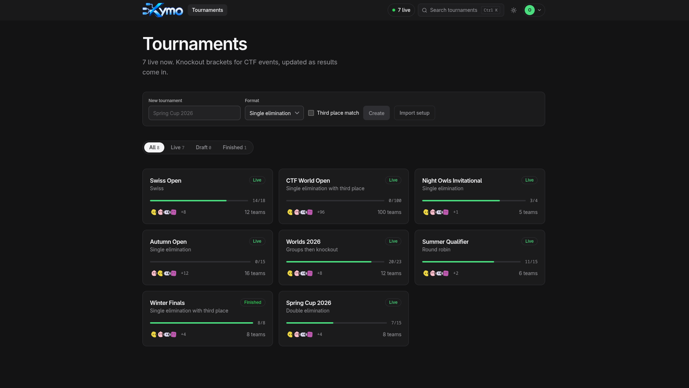
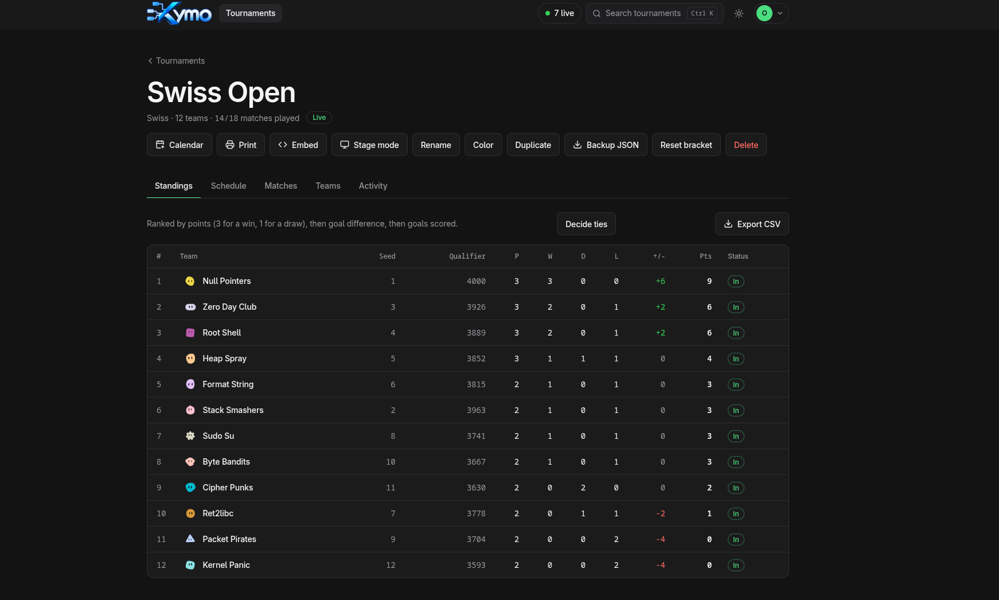
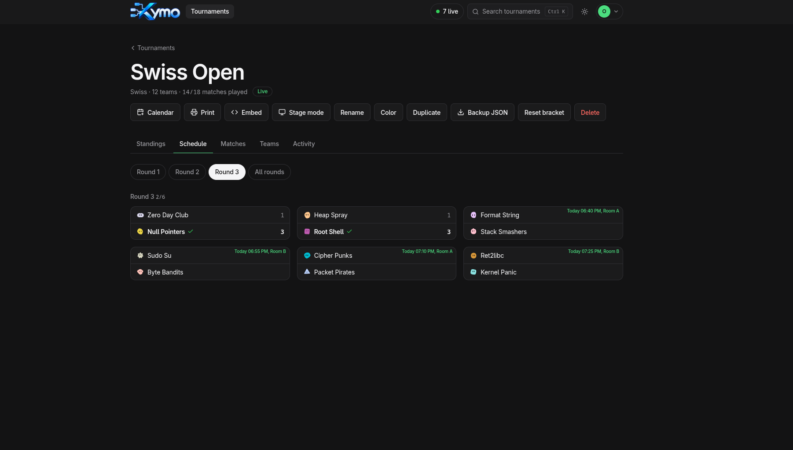
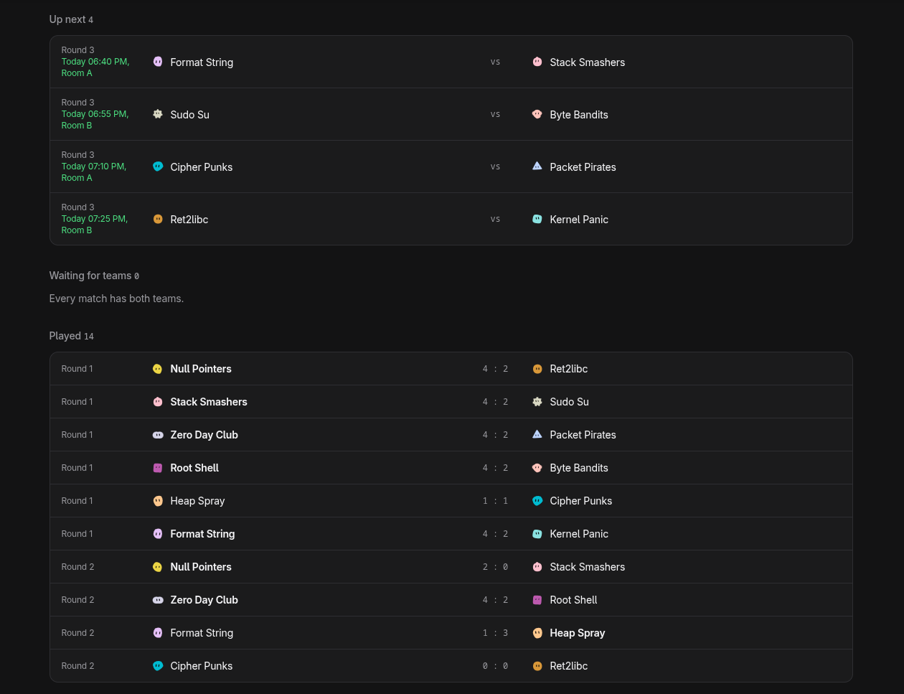
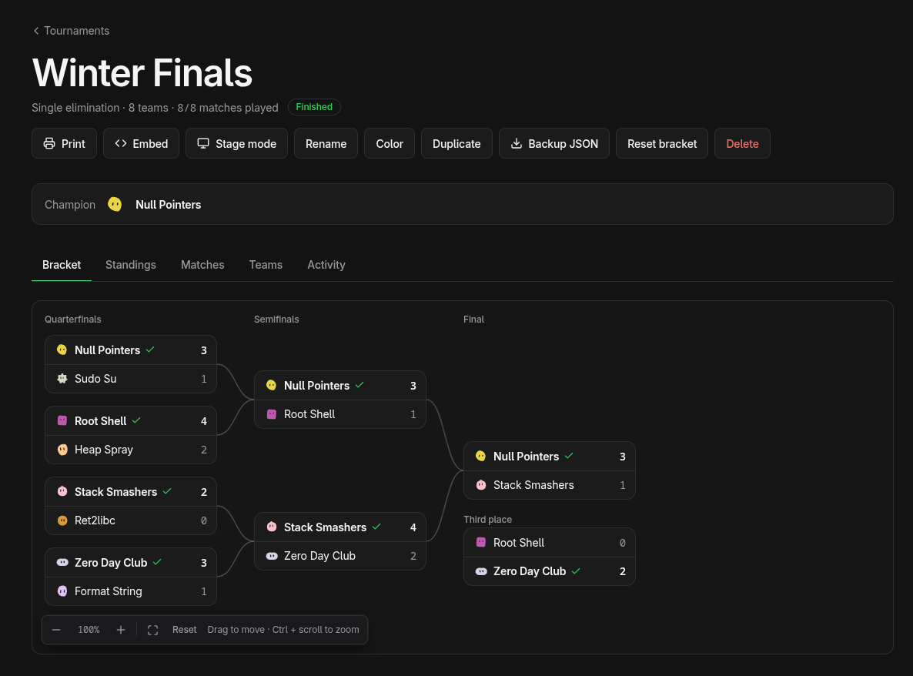
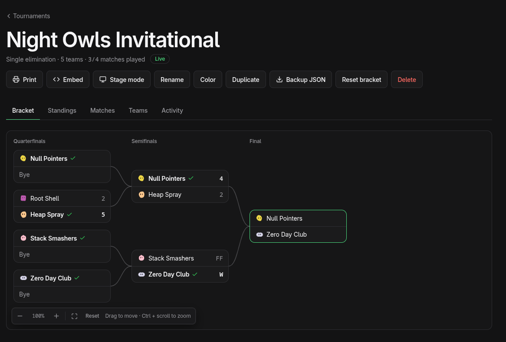
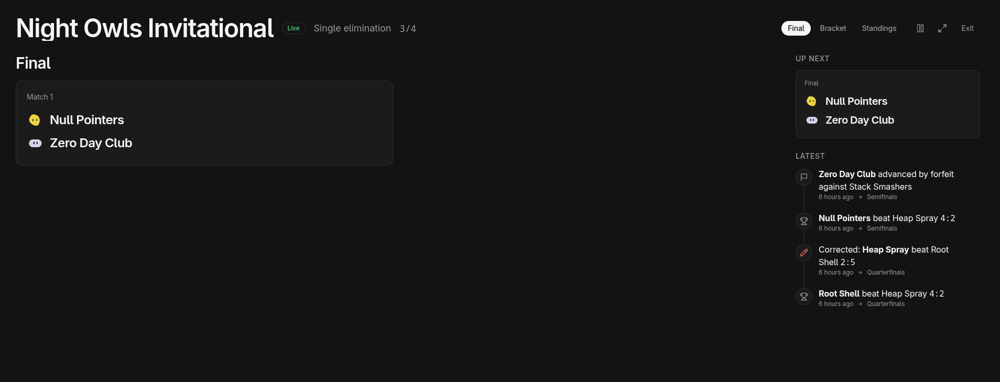
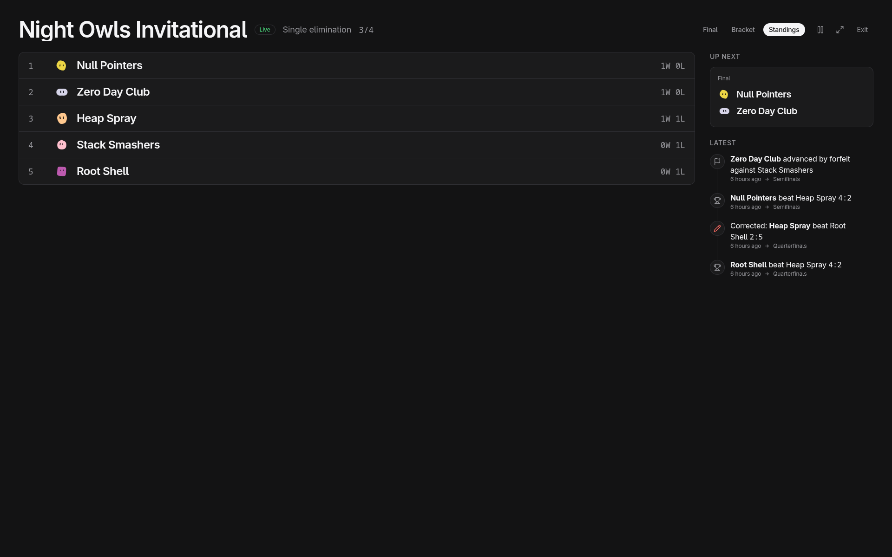
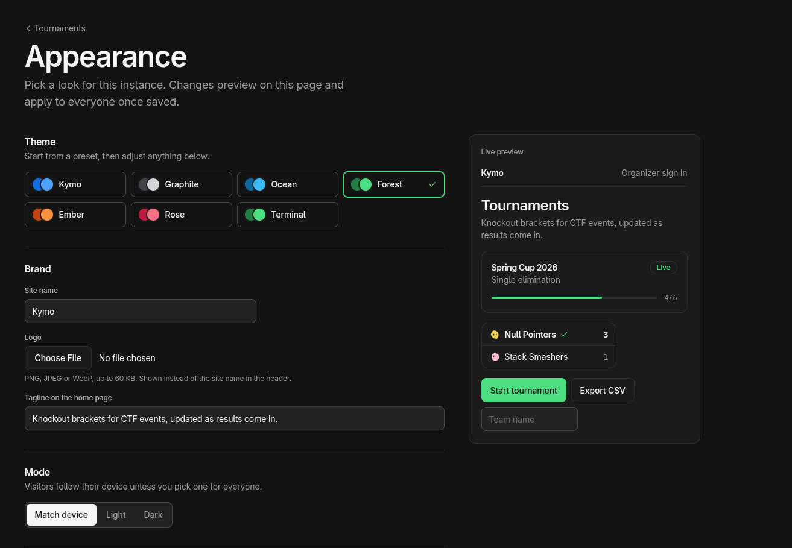

# Kymo

[](https://github.com/Okymi-X/kymo/actions/workflows/ci.yml)
[](https://github.com/Okymi-X/kymo/releases)
[](LICENSE)

Kymo runs CTF events. It is two things in one small program:

- **Jeopardy CTFs**: categories, flags, hints, scoring, a live scoreboard, and challenges that start a private machine for every player or team.
- **Tournaments**: knockout, double elimination, round robin, groups then knockout and Swiss brackets, with a projector view and an embeddable bracket.

It is a Rust API with a React interface and SQLite storage, built into one binary. You host it yourself.



## Start here

| I want to... | Read |
| --- | --- |
| Try it on my machine in five minutes | [Quickstart](#quickstart) |
| Run a bracket tournament | [Running an event](#running-an-event) and [Formats](#formats) |
| Build a Jeopardy CTF | [Challenge guide](docs/CHALLENGES.md) |
| Give every player their own machine | [Lab host guide](docs/LAB_HOST.md) |
| Put it on a server for real players | [Operations guide](docs/OPERATIONS.md) |
| Script it or change the code | [Use the API from a script](#use-the-api-from-a-script) and [Development](#development) |

## Guides

| Guide | What is in it |
| --- | --- |
| [Challenge guide](docs/CHALLENGES.md) | Coding challenges judged automatically, dynamic flags, several flags, Responder challenges, cheating detection and disqualification |
| [Lab host guide](docs/LAB_HOST.md) | Docker and Podman instances, separate lab hosts, virtual machines, manifests, the lab API and its security |
| [Operations guide](docs/OPERATIONS.md) | The monitor and alerts, deploying, Docker, backups, the private VPN per player |
| [Design of dynamic flags and the Responder](docs/DYNAMIC_FLAGS_AND_RESPONDER.md) | The full design, protocol and security reasoning |
| [Architecture](docs/ARCHITECTURE.md) and [Product notes](docs/PRD.md) | How the pieces fit, and what Kymo is for |
| [Sample manifests](deploy/lab/manifests) and [Verifier template](deploy/lab/verifiers/template) | Files to copy when you add a challenge machine, a judge language or a Responder |

## What it does

**Run events**
- Jeopardy events and tournaments side by side, solo or in teams, with registration, time windows, a draft to live to ended lifecycle and a launch checklist that says what still blocks going live.
- Five bracket formats, any of them best of 1, 3, 5 or 7, a live bracket map, standings, schedule, activity log, Stage mode for a projector and embeds.
- A scoreboard that can stay hidden until you publish it, with a freeze, a score over time chart and a ladder across tournaments.

**Build challenges**
- Flag, instance, virtual machine, DFIR questions, coding challenges that are judged on a lab host, and Responder challenges where players patch a machine and a Verifier hands out the flag. Every kind can use a dynamic flag, so each player gets their own.
- Hints with a point cost, attachments, flag formats and regex flags, attempt limits, static or dynamic points, scheduled release.
- Private containers per player with CPU, memory, process and lifetime limits, on this machine or on separate lab hosts, optionally behind a private VPN per player.

**Keep it fair and safe**
- Sharing a dynamic flag is detected and reported, near identical code is flagged for review, and an organizer can disqualify a participant from one event without banning the account. Every step is in the audit log.
- A live monitor with graphs and attack alerts, per endpoint rate limits with automatic and manual bans, a request log, health and backup tools, and event bundles you can export and import.
- Roles for visitors, players, referees, monitors and admins, configurable permissions, API tokens with an expiry, and referee tokens that can only record results.

**Make it yours**
- A front page you shape (edited texts or your own HTML and CSS), site name, logo, colors for light and dark, type and density, link previews and an installable app on phones.
- Webhooks to Discord, Slack or any URL, a calendar feed for scheduled matches, and live updates without refreshing.
- Accessible by default: keyboard operation, visible focus, a skip link, screen reader announcements and themes that follow the device.

## Why Kymo

CTF events have a few recurring problems: a score that is disputed, players asking where they play next, and an organizer page that gets shared on screen by mistake. Kymo is built around those.

- Every result, correction and forfeit goes into a public activity log with its time.
- Players can follow their team and see their next match, time and room.
- The projector view is a separate page with no controls, so nothing private is ever on screen.

## Screenshots

### Standings, schedule and matches

A Swiss tournament in progress. Standings rank by points, goal difference and goals scored. The organizer can decide ties by hand, and the schedule shows one round at a time.







### Brackets

Brackets are a map you can move around. A finished tournament shows its champion, and a live one highlights the match to play next.





### Stage mode

A full screen view for a projector. It rotates between the current round, the bracket and the standings, and keeps what is next and the latest results beside it.





### Appearance

Pick a preset or set your own colors, type, radius, logo, tint and bracket lines. Changes preview live and apply to everyone once saved.



## Quickstart

You need Rust (stable) and Node with pnpm.

```sh
git clone https://github.com/Okymi-X/kymo.git
cd kymo
(cd web && pnpm install && pnpm build)

export KYMO_ADMIN_PASSWORD='at least 12 characters'
cargo run -p kymo-server seed-demo   # optional: sample data for every kind of event
KYMO_ADDR=127.0.0.1:8787 cargo run -p kymo-server
```

Open http://127.0.0.1:8787 and sign in as organizer with that password.

`seed-demo` adds sample data for **both kinds of event** and is safe to run again (it only adds what is missing): eight tournaments in different formats and states, and three Jeopardy events: *Spring Jeopardy CTF* (live, five categories, fifteen challenges with static and dynamic scoring and hints, fourteen players with solves spread over six hours, so the scoreboard and the score-over-time chart have something to show), *Winter Jeopardy* (finished) and *Summer Jeopardy* (upcoming, registration open). The sample players (`demo-ada`, `demo-linus`, ...) have no usable password, so nobody can sign in as them; sign in as the organizer to look around.

**Event types.** A *tournament* has matches and a bracket, so it has no challenges. A *Jeopardy* event has challenges, flags, hints, scoring and, if you want, instances. Choose the type when you create the event; both run side by side.

## Configuration

| Variable | Default | Purpose |
| --- | --- | --- |
| `KYMO_ADMIN_PASSWORD` | required | Organizer password, at least 12 characters |
| `KYMO_ADDR` | `127.0.0.1:8080` | Address to listen on |
| `KYMO_DATABASE_URL` | `sqlite://kymo.db` | SQLite database file, created on first run |
| `KYMO_TRUST_PROXY` | off | Set to `1` behind a reverse proxy so the last `X-Forwarded-For` entry is the client address (needed for correct rate limits and bans) |
| `KYMO_BACKUP_DIR` | off | Directory for scheduled database backups (created private) |
| `KYMO_BACKUP_EVERY_HOURS` | `24` | Hours between scheduled backups |
| `KYMO_BACKUP_KEEP` | `7` | Backups to keep |
| `KYMO_INSTANCES` | off | `docker` runs challenge containers on this machine (events can still use lab hosts); `labs` runs none here and leaves everything to [lab hosts](docs/LAB_HOST.md#separate-lab-host) |
| `KYMO_INSTANCE_HOST` | `127.0.0.1` | Host name players are told to connect to |
| `KYMO_INSTANCE_BIND` | `0.0.0.0` | Address container ports are published on |
| `KYMO_VPN` | off | Set to `1` for a private VPN network per player (needs `KYMO_INSTANCES=docker`) |
| `KYMO_VPN_HOST` | required with the VPN | Name or address players connect to, written into their profiles |
| `KYMO_VPN_PORT` | `1194` | UDP port on the server for the VPN |
| `KYMO_VPN_BIND` | `0.0.0.0` | Address the VPN port is published on |
| `KYMO_VPN_DIR` | `kymo-vpn` | Directory shared with the gateway container (must be a path the container platform can mount) |
| `KYMO_VPN_IMAGE` | `localhost/kymo/vpn-gateway:1` | Gateway image, built from `deploy/vpn-gateway` |
| `KYMO_VPN_TUNNEL` | `10.8.0.0/16` | Address range handed to players' VPN tunnels |
| `KYMO_VPN_LABS` | `10.77.0.0/16` | Range split into one private /27 network per player or team (2048 by default) |
| `KYMO_VPN_CERT_DAYS` | `60` | How long a player's VPN certificate is valid |
| `KYMO_VPN_BIND_OPTIONS` | empty | Extra bind mount options, for example `z` on SELinux hosts |

Everything else, including the look of the site, is stored in the database and changed from the interface.

## Running an event

1. **Create** a tournament from the home page: pick a format and a name.
2. **Add teams**, one per line. Add a qualifier score after a comma to seed by score (`Alpha, 900`).
3. **Seed** by dragging, or choose manual, random or score seeding when you start.
4. **Start**, then enter results from the bracket, the schedule or the matches list. Click a match to enter a score, record a forfeit, or plan a time and place.
5. **Show it**: open Stage mode on the projector, share the tournament link with players, or embed it on your site.

If a result was wrong, correct it from the same dialog. A correction is refused when a later match already depends on it, so the bracket never ends up inconsistent. The newest result can also be undone from the Activity tab.

### Running a Jeopardy event

1. **Create** an event from the Organizer area (Events): choose the type *Jeopardy CTF*, solo or teams, and a name.
2. **Add categories** and **challenges** on the Challenges tab. A challenge needs a title, a category, the way it is delivered (nothing to start, a container, a virtual machine, a coding challenge, a Responder), a flag and points. See the [challenge guide](docs/CHALLENGES.md).
3. **Publish** each challenge when it is ready, and try it with the flag test in the editor.
4. Check the **launch checklist** on the Overview tab: it lists what still blocks going live, such as a challenge that needs an instance but has no lab host.
5. **Open registration**, then **Go live** when it is time. Players register, play in the browser, and the scoreboard updates as they solve.
6. While it runs, watch the Monitor and the Integrity tab, then **End event** and, later, **Archive** it.

## Use the API from a script

Create a token on the API tokens page (choose an expiry), then:

```sh
curl -H "Authorization: Bearer $TOKEN" -H 'Content-Type: application/json' \
  -X PUT http://127.0.0.1:8787/api/v1/admin/tournaments/1/matches/0/result \
  -d '{"score_a": 3, "score_b": 1}'
```

Create a whole tournament from a file. The schema is `docs/schema/tournament-import.schema.json` and an example is `docs/examples/spring-cup.json`:

```sh
curl -H "Authorization: Bearer $TOKEN" -H 'Content-Type: application/json' \
  -X POST http://127.0.0.1:8787/api/v1/admin/import --data @docs/examples/spring-cup.json
```

Everything needs a session (an API token counts) except the sign in pages and the public views of events whose scoreboard is public (see "Home page, sign in and public scoreboards"). An API token cannot create other tokens.

## Home page, sign in and public scoreboards

**Sign in is required.** Every page and API call needs a session, except: the front page, signing in and up, the appearance and home page content, a team's score report (its code is its key), and the read only views of events whose scoreboard is public. The rule lives in one place (`crates/kymo-server/src/gate.rs`), so a new route is closed by default. A stale session is refused, so an expired one reads as signed out.

**Public scoreboards.** An event's *Anyone can see the scoreboard* switch is the only exception. It opens `/s/<event>` (a read only scoreboard with a Sign in button) and, for a tournament, its bracket for the embed, stage and calendar views. Nothing else about the event is open: not its challenges, players or rules. Answers to visitors are reused for 5 seconds, so a crowd costs one computation per event every few seconds. The event update streams send only a "something changed" ping and stay open, because a browser cannot send the session header on them.

**The home page** (Appearance, Home page). In the default page the organizer edits the headline, text, button labels, announcement banner, about section and footer, and switches the events and public scoreboards sections on or off. In custom mode they write HTML and CSS. The HTML is cleaned when saved and again in the browser (no scripts, forms, frames, event handlers or inline styles), shown inside a shadow root so its CSS cannot touch the app, and the CSS cannot load anything from outside (`@import`, outside `url()`), use `position: fixed` or backslash escapes. Links to `/signin`, `/signin?mode=register` and `/events` work as normal links; the sign in forms themselves stay ours. Signed in players see the page with a greeting, their running instance and their live and upcoming events.

**Rules.** Each event can have its own rules (Manage events, the event, Rules): a title and a text. Players open them from a button on the event page. A line starting with `#` is a heading, `-` a list item, and a blank line a new paragraph; nothing is treated as HTML.

## Formats

| Format | Teams | Notes |
| --- | --- | --- |
| Single elimination | 2 to 256 | Byes fill the first round. Optional third place match. |
| Double elimination | 3 to 256 | Winners and losers brackets, grand final and a reset match if the losers side wins. |
| Round robin | 3 to 32 | Everyone plays everyone. 3 points for a win, 1 for a draw. |
| Groups then knockout | 3 to 32 | 2 to 8 groups, 1 to 4 teams per group advance. Same group teams are kept apart in the first knockout round. |
| Swiss | 4 to 256 | 1 to 12 rounds, or log2 of the team count. Each round is paired once the last one is played, with no rematches and one bye at most per team. |

Teams level on points, difference and goals are ordered by the organizer's tiebreak list, then by seed. In a groups tournament that order also decides who qualifies.

## Development

```sh
export KYMO_ADMIN_PASSWORD='at least 12 characters'
KYMO_ADDR=127.0.0.1:8787 cargo run -p kymo-server
cd web && pnpm install && KYMO_API=http://127.0.0.1:8787 pnpm dev
```

Run the checks:

```sh
cargo test && cargo clippy --all-targets -- -D warnings
cd web && pnpm exec tsc -b && pnpm exec vitest run
```

End to end tests start their own server on port 8791 with a throwaway database and drive the organizer flow in Google Chrome. Build the web app first.

```sh
cd web && pnpm build && pnpm e2e
```

Notes for contributors and coding agents live in `docs/`: `RULES.md`, `ARCHITECTURE.md`, `DESIGN.md`, `TASKS.md` and `MEMORY.md`.

## Project layout

```
crates/kymo-engine     pure bracket logic: generation, results, standings, Swiss pairing
crates/kymo-core       pure event rules: lifecycle states, schedule windows, roles, team rosters
crates/kymo-jeopardy   pure Jeopardy rules: flags, static and dynamic scoring, ranking, rate limits
crates/kymo-instances  challenge container lifecycle: policy, runtime interface, Docker and Podman
crates/kymo-verifier   the Verifier: definition format, check runner and the web service players open
crates/kymo-monitor    pure request rules: per endpoint limits, automatic bans, ban expiry
crates/kymo-vpn        per player OpenVPN: certificate authority, profiles, firewall rules, gateway
crates/kymo-lab        the lab host (binary `kymo-lab`) and the client the platform uses to reach it
crates/kymo-server     Axum API, SQLite storage, live updates, serves the built web app
web/                   React, TypeScript, Vite and Tailwind interface, with Playwright tests
deploy/                systemd unit, reverse proxy examples, the VPN gateway image, the lab host installer
lab/                   small example challenge images used by the tests and the demo lab
docs/                  guides (challenges, lab host, operations), product, architecture, design notes, schema, screenshots
```

## Credits and license

Team avatars are generated with [blobatar](https://github.com/Alain00/blobatar) (MIT). The same team name always gets the same avatar.

Released under the MIT license, see `LICENSE`.

## Releases

Releases are automatic. When `version` in `Cargo.toml` has no matching tag, the next push to `main` builds the web app and the server on Ubuntu 22.04 and publishes a GitHub release `vX.Y.Z` with a Linux x86_64 tarball (the server with the web app embedded, plus `deploy/` and the guides in `docs/`), a separate lab host tarball with its manifests, Verifier template and guides, and a SHA-256 checksum for each. To release: bump the version, commit, push. Pushing a `v*` tag by hand or running the workflow from the Actions tab works too. Check a download with `sha256sum -c kymo-vX.Y.Z-linux-x86_64.tar.gz.sha256`.
