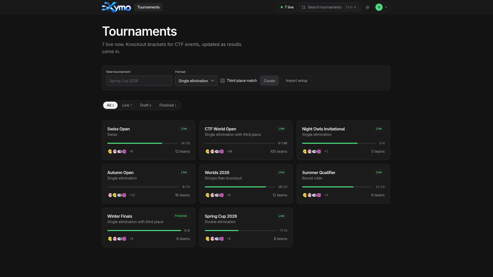
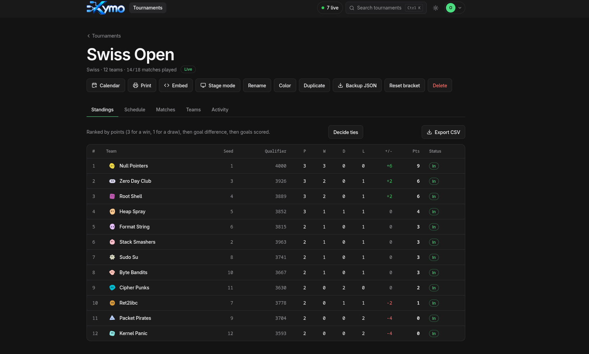
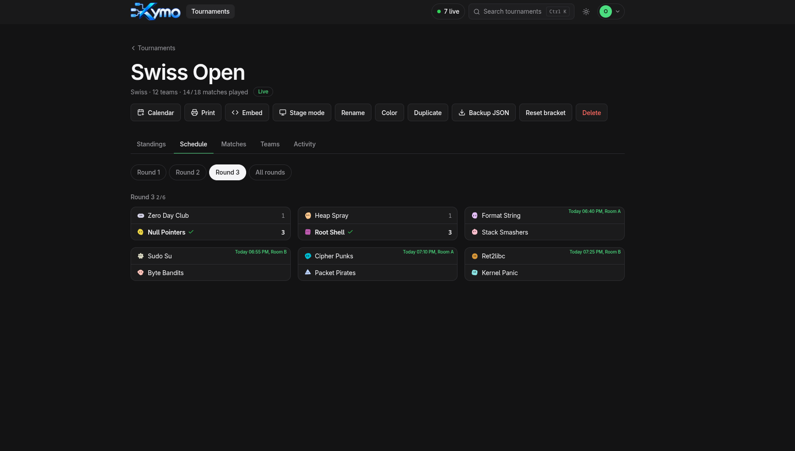
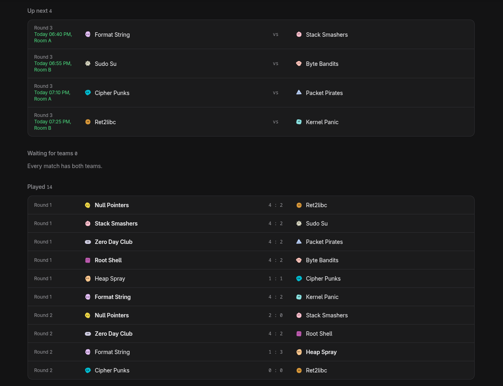
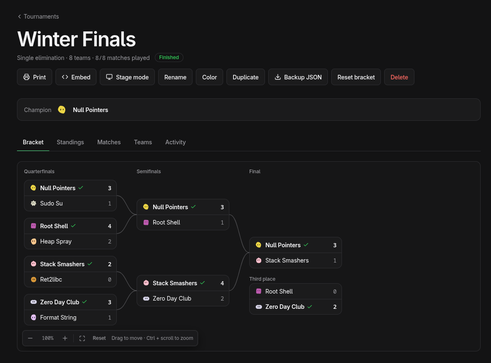
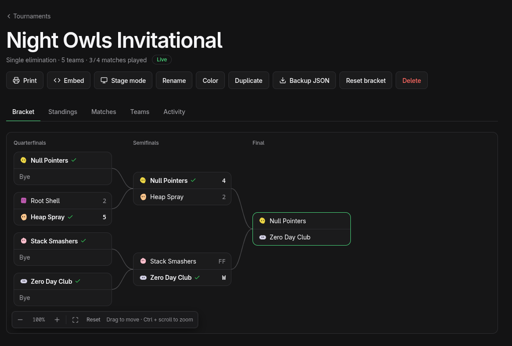
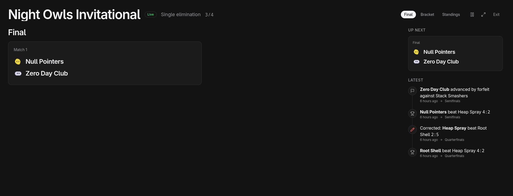
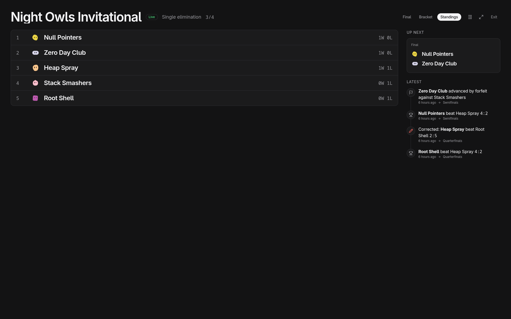
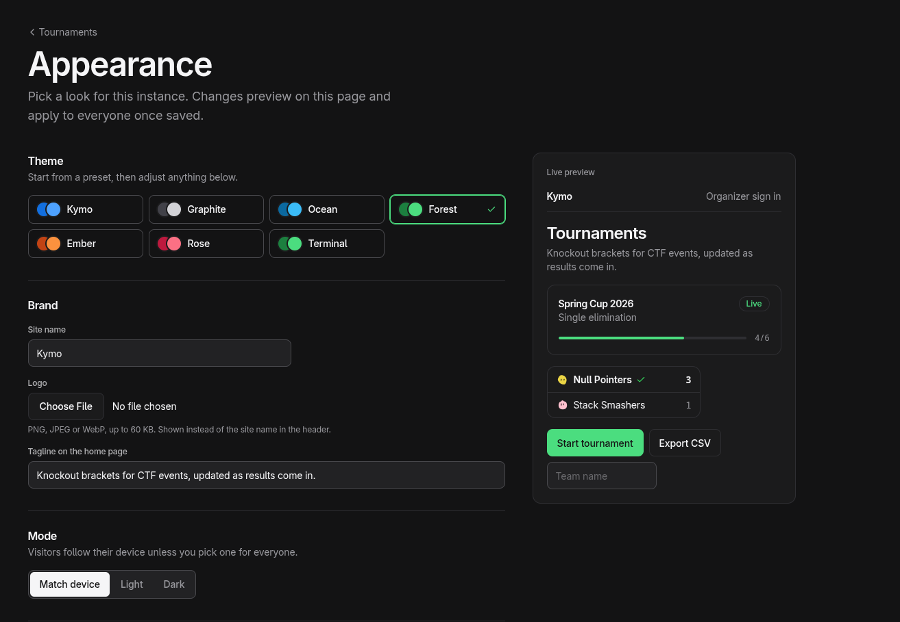

# Kymo

[](https://github.com/Okymi-X/kymo/actions/workflows/ci.yml)
[](https://github.com/Okymi-X/kymo/releases)
[](LICENSE)

Open source tournament manager for CTF events. Run a knockout, double elimination, round robin, groups then knockout or Swiss tournament, show it live on a projector, and embed it on any site. A Rust API with a React interface and SQLite storage, in one small binary.



## Contents

- [Why Kymo](#why-kymo)
- [Features](#features)
- [Screenshots](#screenshots)
- [Quickstart](#quickstart)
- [Configuration](#configuration)
- [Running an event](#running-an-event)
- [Use the API from a script](#use-the-api-from-a-script)
- [Formats](#formats)
- [Run with Docker](#run-with-docker)
- [Development](#development)
- [Project layout](#project-layout)
- [Credits and license](#credits-and-license)

## Why Kymo

CTF events have a few recurring problems: a score that is disputed, players asking where they play next, and an organizer page that gets shared on screen by mistake. Kymo is built around those.

- Every result, correction and forfeit goes into a public activity log with its time.
- Players can follow their team and see their next match, time and room.
- The projector view is a separate page with no controls, so nothing private is ever on screen.

## Features

- **Five formats:** single elimination (optional third place match), double elimination, round robin, groups then knockout, and Swiss.
- **Organizer tools:** enter and correct scores, forfeits, undo the newest result, schedule matches with a place, drag teams into seeding order, seed by qualifier score or at random, decide ties by hand, rename, duplicate, back up as JSON, import a setup file.
- **A live map of the bracket:** drag it, zoom at the cursor, jump with the minimap. Every format has a Bracket tab.
- **Standings, schedule, matches, teams, activity:** all paginated with search, so a 100 team event stays readable.
- **Stage mode** at `/t/{slug}/stage`: a rotating projector view with the current round, standings and the latest results. It fits one screen with no scrolling.
- **Embeds** at `/embed/{slug}`: copy an iframe snippet from the Embed button. Only these pages may be framed.
- **Calendar feed** at `/api/v1/tournaments/{slug}/calendar.ics` for scheduled matches.
- **Appearance in the database:** site name, logo, colors for light and dark, type, corner radius, density, page tint, bracket line style and team avatars. A tournament can also carry its own accent color.
- **Live updates** over server sent events, with no page refresh.
- **API tokens** with an expiry for scripts and score importers.
- **Accessible by default:** keyboard operation, visible focus, a skip link, screen reader announcements while reordering teams, and light and dark themes that follow the device.

## Screenshots

### Standings, schedule and matches

A Swiss tournament in progress. Standings rank by points, goal difference and goals scored. The organizer can decide ties by hand, and the schedule shows one round at a time.







### Brackets

Brackets are a map you can move around. A finished tournament shows its champion, and a live one highlights the match to play next.





### Stage mode

A full screen view for a projector. It rotates between the current round, the bracket and the standings, and keeps what is next and the latest results beside it.





### Appearance

Pick a preset or set your own colors, type, radius, logo, tint and bracket lines. Changes preview live and apply to everyone once saved.



## Quickstart

You need Rust (stable) and Node with pnpm.

```sh
git clone https://github.com/Okymi-X/kymo.git
cd kymo
(cd web && pnpm install && pnpm build)

export KYMO_ADMIN_PASSWORD='at least 12 characters'
cargo run -p kymo-server seed-demo   # optional: eight sample tournaments
KYMO_ADDR=127.0.0.1:8787 cargo run -p kymo-server
```

Open http://127.0.0.1:8787 and sign in as organizer with that password.

## Configuration

| Variable | Default | Purpose |
| --- | --- | --- |
| `KYMO_ADMIN_PASSWORD` | required | Organizer password, at least 12 characters |
| `KYMO_ADDR` | `127.0.0.1:8080` | Address to listen on |
| `KYMO_DATABASE_URL` | `sqlite://kymo.db` | SQLite database file, created on first run |

Everything else, including the look of the site, is stored in the database and changed from the interface.

## Running an event

1. **Create** a tournament from the home page: pick a format and a name.
2. **Add teams**, one per line. Add a qualifier score after a comma to seed by score (`Alpha, 900`).
3. **Seed** by dragging, or choose manual, random or score seeding when you start.
4. **Start**, then enter results from the bracket, the schedule or the matches list. Click a match to enter a score, record a forfeit, or plan a time and place.
5. **Show it**: open Stage mode on the projector, share the tournament link with players, or embed it on your site.

If a result was wrong, correct it from the same dialog. A correction is refused when a later match already depends on it, so the bracket never ends up inconsistent. The newest result can also be undone from the Activity tab.

## Use the API from a script

Create a token on the API tokens page (choose an expiry), then:

```sh
curl -H "Authorization: Bearer $TOKEN" -H 'Content-Type: application/json' \
  -X PUT http://127.0.0.1:8787/api/v1/admin/tournaments/1/matches/0/result \
  -d '{"score_a": 3, "score_b": 1}'
```

Create a whole tournament from a file. The schema is `docs/schema/tournament-import.schema.json` and an example is `docs/examples/spring-cup.json`:

```sh
curl -H "Authorization: Bearer $TOKEN" -H 'Content-Type: application/json' \
  -X POST http://127.0.0.1:8787/api/v1/admin/import --data @docs/examples/spring-cup.json
```

Reads are public: `GET /api/v1/tournaments` and `GET /api/v1/tournaments/{slug}`. An API token cannot create other tokens.

## Formats

| Format | Teams | Notes |
| --- | --- | --- |
| Single elimination | 2 to 256 | Byes fill the first round. Optional third place match. |
| Double elimination | 3 to 256 | Winners and losers brackets, grand final and a reset match if the losers side wins. |
| Round robin | 3 to 32 | Everyone plays everyone. 3 points for a win, 1 for a draw. |
| Groups then knockout | 3 to 32 | 2 to 8 groups, 1 to 4 teams per group advance. Same group teams are kept apart in the first knockout round. |
| Swiss | 4 to 256 | 1 to 12 rounds, or log2 of the team count. Each round is paired once the last one is played, with no rematches and one bye at most per team. |

Teams level on points, difference and goals are ordered by the organizer's tiebreak list, then by seed. In a groups tournament that order also decides who qualifies.

## Run with Docker

```sh
KYMO_ADMIN_PASSWORD='at least 12 characters' docker compose up --build
```

The app serves the interface and the API on port 8080. Data lives in the `kymo-data` volume.

## Development

```sh
export KYMO_ADMIN_PASSWORD='at least 12 characters'
KYMO_ADDR=127.0.0.1:8787 cargo run -p kymo-server
cd web && pnpm install && KYMO_API=http://127.0.0.1:8787 pnpm dev
```

Run the checks:

```sh
cargo test && cargo clippy --all-targets -- -D warnings
cd web && pnpm exec tsc -b && pnpm exec vitest run
```

End to end tests start their own server on port 8791 with a throwaway database and drive the organizer flow in Google Chrome. Build the web app first.

```sh
cd web && pnpm build && pnpm e2e
```

Notes for contributors and coding agents live in `docs/`: `RULES.md`, `ARCHITECTURE.md`, `DESIGN.md`, `TASKS.md` and `MEMORY.md`.

## Project layout

```
crates/kymo-engine   pure bracket logic: generation, results, standings, Swiss pairing
crates/kymo-server   Axum API, SQLite storage, live updates, serves the built web app
web/                 React, TypeScript, Vite and Tailwind interface, with Playwright tests
docs/                product, architecture, design notes, import schema and screenshots
```

## Credits and license

Team avatars are generated with [blobatar](https://github.com/Alain00/blobatar) (MIT). The same team name always gets the same avatar.

Released under the MIT license, see `LICENSE`.
